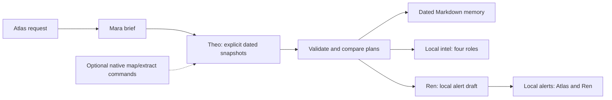

# Nimble Pricing Monitor

Compare dated competitor-pricing snapshots, retain the evidence sources, and prepare a concise change summary for different team roles. Atlas requests tracking, Mara defines the brief, Theo compares the snapshots, and Ren prepares the local alert. The demo uses fictional pricing data so the workflow runs without accounts, API keys or external messages.

The collection command adapter follows the public [Nimble competitor-positioning skill](https://github.com/Nimbleway/agent-skills), while the team and room split follows the [Alook](https://github.com/alookai/alook) integration pattern.

## Run

Python 3.10+; no Python packages required.

```powershell
python -B app.py demo
python -B app.py demo --output-dir artifacts/run-01
python -B app.py view --run-dir artifacts/run-01 --room alerts --agent Ren
python -B -m unittest discover -s tests -v
```

The default demo prints JSON without writing files. Supplying a fresh output directory writes dated Markdown snapshots, a unified diff report, role-specific room files, and `run.json`. It refuses to overwrite an existing run. The example compares September 9 and October 23 snapshots and identifies four semantic changes. Numeric values such as `79` and `79.00` compare equally. Currency, billing period, price, features, added plans and removed plans are compared explicitly; no currency conversion or annual-to-monthly equivalence is invented.

The local `view` command allows all four roles into `intel` and only Atlas/Ren into `alerts`. This is an application demonstration, **not filesystem security**: anyone with access to the output folder can read the files. Protect real artifacts using actual user access controls.

## Native collection boundary

```powershell
python -B app.py native-commands --url https://example.com/pricing
```

This prints, without executing, the documented commands:

```text
nimble --client-source nimble-agent-skills map --url URL --sitemap only --limit 200
nimble --client-source nimble-agent-skills extract --url URL --format markdown
```

Using them separately requires an installed Nimble CLI and your process `NIMBLE_API_KEY`, and incurs external API use. Preserve the raw output as evidence, then prepare a `human-normalized` snapshot in the included format. The program intentionally does not guess a response envelope or pretend to extract trustworthy prices from arbitrary Markdown. Use `--baseline` and `--current` with the `demo` command to compare those normalized files. API keys never belong in snapshots or URLs.

## Architecture



## Code map

| File | Responsibility |
|---|---|
| `app.py` | Bounded snapshot loader, Decimal price validation, semantic comparison, Markdown persistence, local room membership checks, native command adapter and CLI. |
| `fixtures/baseline.json` | Fictional September 9 plans with source URLs and declared synthetic provenance. |
| `fixtures/current.json` | Fictional October 23 prices/features and an added Business plan. |
| `tests/test_app.py` | Price equivalence, plan/period changes, chronology, malformed data, role boundaries, overwrite prevention and CLI contracts. |
| `requirements.txt` | Standard-library requirement. |
| `.gitignore` | Generated runs, caches and local secrets exclusions. |

## Input contract and limits

A snapshot declares `competitor`, ISO `date`, `source_kind` (`synthetic` or `human-normalized`), credential-free HTTPS `sources`, and nonempty uniquely named `plans`. Each plan has currency (`USD`, `EUR`, `GBP`), period (`month`, `year`), finite nonnegative `amount` up to one billion with at most six fractional digits, and a text `features` array. Current dates must be later than baseline dates. Files are limited to 2 MiB. These are example bounds, not provider limits.

The extraction command shape was checked against [skill revision `18bc1f4`](https://github.com/Nimbleway/agent-skills/tree/18bc1f4007f7a7b0b912d4fd44cfdf5e47b34771), with [v1.7.0](https://github.com/Nimbleway/agent-skills/blob/v1.7.0/skills/competitor-positioning/SKILL.md) as the earlier compatible command reference. No upstream implementation is vendored. Native Nimble/Alook execution, real pricing accuracy, scheduled collection, autonomous extraction, persistent agent sessions and external alert delivery were not verified or performed. `quality_evidence: false` marks the absence of a quality evaluation. The demo sends no messages.
